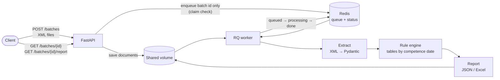

# NFS-e Audit Pipeline

[](https://github.com/GuilhermeScarpini/nfse-audit-pipeline/actions/workflows/ci.yml)
[](LICENSE)


Asynchronous pipeline that audits Brazilian service invoices (NFS-e, national layout) against **tax rules versioned by effective date**, covering the 2026–2027 tax reform transition (IBS/CBS replacing PIS/COFINS).

Upload a batch of invoice XMLs; get back, for every invoice and every rule, the **expected value, the value found, the status and the legal basis**, as JSON or Excel.

> **All data is synthetic**, generated by the project itself. No real invoices, companies or people.

## Why

Companies that buy services must check every invoice they receive and withhold the right federal taxes. Getting it wrong makes the buyer liable. From 2026 the tax reform adds IBS and CBS to every invoice, with rates and rules that change year by year until 2033. The same service can therefore be correct in December 2026 and wrong in January 2027.

This project treats that as a data problem: each rule is a pure function, and the rates come from tables versioned by effective date, each citing its law.

## Architecture



1. **Batch ingestion.** The API stores the files and enqueues **only the batch id**. It answers `202 Accepted` in milliseconds, whatever the batch size. An `Idempotency-Key` header makes retries safe.
2. **Extraction.** National NFS-e XML (layout v1.01) is parsed into Pydantic models. Parsing is hardened: any DOCTYPE is rejected, which blocks XXE and billion-laughs attacks.
3. **Deterministic rule engine.** The table version in force is chosen by the invoice's **competence date**.
4. **Auditable reports.** Every rule checked, with expected and found values, status (`ok` / `divergent` / `not_applicable` / `error`), legal basis and the exact table version applied.

## Example: the same rate, two years

The synthetic municipality raises the ISS rate for software licensing (subitem 01.05) from 2% to 2.5% on 2027-01-01. Two invoices, one month apart, both charge 2%:

| Invoice | Rule | Expected | Found | Status | Table version |
|---|---|---|---|---|---|
| December 2026 | `ISS_RATE_MUNICIPAL` | 0.02 | 0.02 | ok | `iss_9999999 2026-01-01..2026-12-31` |
| January 2027 | `ISS_RATE_MUNICIPAL` | 0.025 | 0.02 | **divergent** | `iss_9999999 2027-01-01..` |

No code changed between the two: only the table version did. When the law changes, the fix is a new table entry with its legal basis.

## Rules

| Rule | What it checks |
|---|---|
| `ISS_RATE_RANGE` | ISS between 2% and 5% (LC 116/2003) |
| `ISS_RATE_MUNICIPAL` | ISS rate matches the municipal table for the service |
| `ISS_AMOUNT` | ISS = base × rate |
| `IRRF_WITHHOLDING` | 1.5% / 1% by service type, R$ 10 waiver, Simples Nacional exemption |
| `PIS/COFINS/CSLL_WITHHOLDING` | Lei 10.833/2003; **from 2027 only CSLL** (LC 214/2025) |
| `IBS_CBS_BASE` | base net of ISS (and of PIS/COFINS in 2026) |
| `CBS/IBS_STATE/IBS_MUNICIPAL_AMOUNT` | 2026 test rates; 2027 split; mandatory from Oct/2026 |

Every table entry cites its legal basis and carries a `verified` flag. The **2027 CBS reference rate** has not been published by the Senate yet, so CBS checks for 2027 report `error` rather than guessing a value.

## Quick start

### Command line

Requires [uv](https://docs.astral.sh/uv/).

```bash
uv sync
uv run nfse-audit generate --out data/synthetic   # 16 scenarios with planted errors + 2 malformed files
uv run nfse-audit audit data/synthetic --out reports
uv run nfse-audit validate data/synthetic/0*.xml   # official XSD v1.01
uv run pytest
```

```
               documents: 18
        invoices_audited: 16
   documents_with_errors: 2
             invoices_ok: 4
      invoices_divergent: 8
          invoices_error: 4
```

Open the `.xlsx` in `reports/`: one row per rule per invoice. Each file name in `data/synthetic/` says which error was planted, e.g. `006-irrf-not-withheld.xml`.

### Full stack with Docker Compose

API + worker + Redis, with a shared volume for the batch documents:

```bash
docker compose up --build --wait                 # API on http://localhost:8000 (docs at /docs)
curl -F "files=@data/synthetic/006-irrf-not-withheld.xml" http://localhost:8000/batches
curl http://localhost:8000/batches/<batch_id>                     # queued → processing → done
curl -o audit.xlsx "http://localhost:8000/batches/<batch_id>/report?format=xlsx"
./scripts/smoke-test.sh                          # end-to-end check, also run in CI
```

The image is multi-stage (uv only in the build stage), pinned by digest and runs as a non-root user. Behind a TLS-inspecting proxy, see [`docker-compose.override.example.yml`](docker-compose.override.example.yml).

## Engineering notes

- **Money is `Decimal`, never `float`**, with explicit rounding.
- **Alphanumeric CNPJ** (mandatory from July 2026) is supported in the domain model and in the schema.
- **Idempotency in two layers**: `Idempotency-Key` bound atomically with Redis `SET NX`, and jobs that can safely run twice (at-least-once delivery).
- **Dependency injection** with FastAPI `Depends`: the integration tests swap Redis and the queue for in-memory fakes.
- **CI**: lint, tests, a Docker Compose smoke test of the whole stack, and a secret scan of the full git history. Actions are pinned by commit SHA and Dependabot keeps everything current.
- **Decisions are recorded** as ADRs in [`docs/adr/`](docs/adr/) (in Portuguese).

## Synthetic data

- **CNPJs start with `SY`.** That is the alphanumeric CNPJ format, valid since July 2026, so these numbers cannot clash with a real numeric CNPJ.
- **The demo municipality `9999999` does not exist.** It is used to demonstrate a rate change on 2027-01-01.
- **Documents are unsigned** and marked as the test environment (`tpAmb=2`).
- **Each scenario lists the rules it must flag** (`manifest.json`), and the test suite checks this end to end.

## Official schemas

The national NFS-e XSD v1.01 is vendored byte-for-byte, with provenance and hashes. Three adaptations are applied in memory, each documented in [`SOURCE.md`](src/nfse_audit/extraction/schemas/v1.01/SOURCE.md):

- alphanumeric CNPJ;
- signature made optional, for the unsigned synthetic documents;
- a fix for an invalid `^…$` pattern in `TSSerieDPS`, which makes standards-conforming validators reject every series.

## Limitations and next steps

- The 2027 CBS reference rate is pending (expected by 15 Dec 2026). Updating it is a data change with a legal citation.
- A few table entries are marked `verified: false` (e.g. the mapping from income tax categories to service codes) and need review.
- IBS/CBS for Simples Nacional companies (NT 009, layout v1.04) is not modelled yet.
- The API has no authentication; Compose publishes it on localhost only.
- After the MVP: PDF extraction, Postgres for status and reports, object storage, INSS withholding, more municipalities.

Detailed status (in Portuguese): [`docs/NEXT_STEPS.md`](docs/NEXT_STEPS.md).

## How this was built

I built this project with the help of AI (Claude Code), which wrote much of the implementation. Scope, architecture and technical decisions are mine, and the reasoning behind each is recorded in the [ADRs](docs/adr/). The instructions the AI followed are in [`CLAUDE.md`](CLAUDE.md).

## Tech stack

Python 3.12 · FastAPI · Redis + RQ · Pydantic v2 · lxml · openpyxl · pytest · uv · Docker Compose · GitHub Actions

## License

[MIT](LICENSE)
