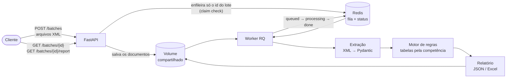

# NFS-e Audit Pipeline

[](https://github.com/GuilhermeScarpini/nfse-audit-pipeline/actions/workflows/ci.yml)
[](LICENSE)


Pipeline assíncrono que audita notas fiscais de serviço eletrônicas (NFS-e, padrão nacional) contra **regras tributárias versionadas por data de vigência**, cobrindo a transição da reforma tributária de 2026–2027 (IBS/CBS substituindo PIS/COFINS).

Você envia um lote de XMLs e recebe, para cada nota e cada regra, o **valor esperado, o valor encontrado, o status e a base legal**, em JSON ou Excel.

> **Todos os dados são sintéticos**, gerados pelo próprio projeto. Nenhuma nota, empresa ou pessoa real.

## Por quê

Quem contrata serviços precisa conferir cada nota recebida e reter os tributos federais corretos. Se errar, a responsabilidade é de quem contratou. A partir de 2026, a reforma tributária acrescenta IBS e CBS a todas as notas, com alíquotas e regras que mudam ano a ano até 2033. O mesmo serviço pode estar certo em dezembro de 2026 e errado em janeiro de 2027.

Este projeto trata isso como um problema de dados: cada regra é uma função pura, e as alíquotas vêm de tabelas versionadas por data de vigência, cada uma citando a lei de origem.

## Arquitetura



1. **Recebimento do lote.** A API grava os arquivos e enfileira **só o id do lote**. Responde `202 Accepted` em milissegundos, qualquer que seja o tamanho do lote. O header `Idempotency-Key` torna o reenvio seguro.
2. **Extração.** O XML da NFS-e nacional (layout v1.01) vira modelos Pydantic. A leitura é protegida: qualquer DOCTYPE é rejeitado, o que bloqueia ataques de XXE e *billion laughs*.
3. **Motor de regras determinístico.** A versão da tabela é escolhida pela **data de competência** da nota.
4. **Relatórios auditáveis.** Cada regra verificada, com valor esperado e encontrado, status (`ok` / `divergent` / `not_applicable` / `error`), base legal e a versão exata da tabela aplicada.

## Exemplo: a mesma alíquota, dois anos

O município sintético aumenta o ISS de licenciamento de software (subitem 01.05) de 2% para 2,5% em 01/01/2027. Duas notas, com um mês de diferença, cobram 2%:

| Nota | Regra | Esperado | Encontrado | Status | Versão da tabela |
|---|---|---|---|---|---|
| Dezembro de 2026 | `ISS_RATE_MUNICIPAL` | 0.02 | 0.02 | ok | `iss_9999999 2026-01-01..2026-12-31` |
| Janeiro de 2027 | `ISS_RATE_MUNICIPAL` | 0.025 | 0.02 | **divergent** | `iss_9999999 2027-01-01..` |

Nenhuma linha de código mudou entre as duas: só a versão da tabela. Quando a lei muda, a correção é uma nova entrada na tabela, com a base legal.

## Regras

| Regra | O que verifica |
|---|---|
| `ISS_RATE_RANGE` | ISS entre 2% e 5% (LC 116/2003) |
| `ISS_RATE_MUNICIPAL` | Alíquota de ISS igual à da tabela do município para o serviço |
| `ISS_AMOUNT` | ISS = base × alíquota |
| `IRRF_WITHHOLDING` | 1,5% ou 1% conforme o serviço, dispensa até R$ 10, isenção para o Simples Nacional |
| `PIS/COFINS/CSLL_WITHHOLDING` | Lei 10.833/2003; **a partir de 2027, só a CSLL** (LC 214/2025) |
| `IBS_CBS_BASE` | Base sem o ISS (e sem PIS/COFINS em 2026) |
| `CBS/IBS_STATE/IBS_MUNICIPAL_AMOUNT` | Alíquotas de teste de 2026; divisão de 2027; obrigatório desde outubro de 2026 |

Cada entrada das tabelas cita sua base legal e tem uma marcação `verified`. A **alíquota de referência da CBS para 2027** ainda não foi publicada pelo Senado, então as verificações de CBS de 2027 retornam `error` em vez de adivinhar um valor.

## Como rodar

### Linha de comando

Requer o [uv](https://docs.astral.sh/uv/).

```bash
uv sync
uv run nfse-audit generate --out data/synthetic   # 16 cenários com erros propositais + 2 arquivos malformados
uv run nfse-audit audit data/synthetic --out reports
uv run nfse-audit validate data/synthetic/0*.xml   # XSD oficial v1.01
uv run pytest
```

```
               documents: 18
        invoices_audited: 16
   documents_with_errors: 2
             invoices_ok: 4
      invoices_divergent: 8
          invoices_error: 4
```

Abra o `.xlsx` em `reports/`: uma linha por regra de cada nota. O nome de cada arquivo em `data/synthetic/` diz qual erro foi plantado, por exemplo `006-irrf-not-withheld.xml` (IRRF não retido).

### Stack completa com Docker Compose

API + worker + Redis, com um volume compartilhado para os documentos do lote:

```bash
docker compose up --build --wait                 # API em http://localhost:8000 (documentação em /docs)
curl -F "files=@data/synthetic/006-irrf-not-withheld.xml" http://localhost:8000/batches
curl http://localhost:8000/batches/<batch_id>                     # queued → processing → done
curl -o auditoria.xlsx "http://localhost:8000/batches/<batch_id>/report?format=xlsx"
./scripts/smoke-test.sh                          # teste de ponta a ponta, também roda no CI
```

A imagem é multi-stage (o uv só existe no estágio de build), fixada por digest e roda sem root. Atrás de um proxy que inspeciona TLS, veja [`docker-compose.override.example.yml`](docker-compose.override.example.yml).

## Notas de engenharia

- **Dinheiro é `Decimal`, nunca `float`**, com arredondamento explícito.
- **CNPJ alfanumérico** (obrigatório desde julho de 2026) suportado no modelo de domínio e no schema.
- **Idempotência em duas camadas**: `Idempotency-Key` vinculado de forma atômica com `SET NX` no Redis, e jobs que podem rodar duas vezes sem efeito colateral (entrega "pelo menos uma vez").
- **Injeção de dependência** com `Depends` do FastAPI: os testes de integração trocam o Redis e a fila por versões em memória.
- **CI**: lint, testes, teste de fumaça da stack Docker inteira e varredura de segredos em todo o histórico do git. As actions são fixadas por SHA, e o Dependabot mantém tudo atualizado.
- **Decisões registradas** como ADRs em [`docs/adr/`](docs/adr/).

## Dados sintéticos

- **Os CNPJs começam com `SY`.** É o formato alfanumérico, válido desde julho de 2026, então não podem coincidir com um CNPJ numérico real.
- **O município de demonstração `9999999` não existe.** Ele serve para mostrar uma mudança de alíquota em 01/01/2027.
- **Os documentos não são assinados** e estão marcados como ambiente de testes (`tpAmb=2`).
- **Cada cenário lista as regras que deve acusar** (`manifest.json`), e os testes conferem isso de ponta a ponta.

## Schemas oficiais

O XSD nacional da NFS-e v1.01 está no repositório byte a byte, com procedência e hashes. Três adaptações são aplicadas em memória, cada uma documentada em [`SOURCE.md`](src/nfse_audit/extraction/schemas/v1.01/SOURCE.md):

- CNPJ alfanumérico;
- assinatura opcional, para os documentos sintéticos sem assinatura;
- correção de um padrão `^…$` inválido em `TSSerieDPS`, que faz validadores que seguem a norma rejeitarem qualquer série.

## Limitações e próximos passos

- A alíquota de referência da CBS de 2027 está pendente (prevista até 15/12/2026). Atualizá-la é uma mudança de dados, com citação legal.
- Algumas entradas das tabelas estão com `verified: false` (por exemplo, o mapeamento das categorias do IRRF para os códigos de serviço) e precisam de revisão.
- IBS/CBS para empresas do Simples Nacional (NT 009, layout v1.04) ainda não está modelado.
- A API não tem autenticação; o Compose só a expõe em localhost.
- Depois do MVP: extração de PDF, Postgres para status e relatórios, armazenamento de objetos, retenção de INSS e mais municípios.

Status detalhado: [`docs/NEXT_STEPS.md`](docs/NEXT_STEPS.md).

## Como foi construído

Construí este projeto com a ajuda de IA (Claude Code), que escreveu boa parte da implementação. O escopo, a arquitetura e as decisões técnicas são meus, e o raciocínio por trás de cada uma está registrado nos [ADRs](docs/adr/). As instruções que a IA seguiu estão no [`CLAUDE.md`](CLAUDE.md).

## Tecnologias

Python 3.12 · FastAPI · Redis + RQ · Pydantic v2 · lxml · openpyxl · pytest · uv · Docker Compose · GitHub Actions

## Licença

[MIT](LICENSE)
